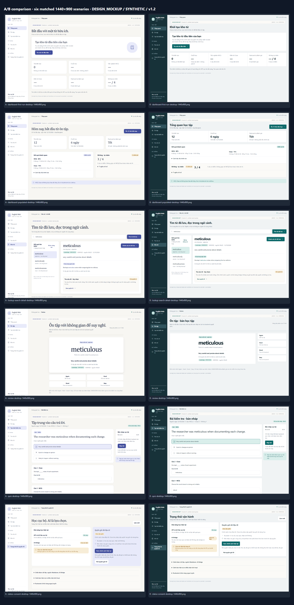
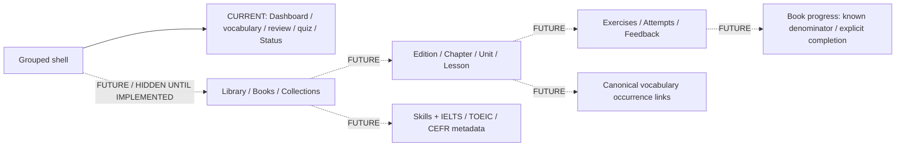

# UXR-01 direction comparison — v1.2

**CURRENT_SELECTION:** **B — Compact Study Console v1.2, OWNER_APPROVED** on 13/10/2026. Direction A and the 0–3 comparison remain historical pre-owner-selection evidence. Both directions are standalone browser-rendered mockups with synthetic content; scores are design judgments, not measured task success, runtime performance or WCAG conformance.

**Owner-approved decisions:** D1/D2/D3/D4/D6/D8/D9 are recorded in [the final decision sheet](UXR-01-DESIGN-DECISION.md). D5 remains deferred to UXR-06 and D7 remains future/unapproved.

Open [Direction A gallery](UXR-01-VISUAL-GALLERY.md#direction-a-v12), [Direction B gallery](UXR-01-VISUAL-GALLERY.md#direction-b-v12), or the [six-scenario side-by-side board](assets/contact-sheets/ab-comparison.png). Every original PNG is linked individually in the gallery.

## Spatial and visual thesis

**A — Calm Academic Workspace.** A quiet 238px desktop rail supports a bounded reading area. Cambria headings distinguish study content; Segoe UI controls stay familiar. Warm paper surfaces, restrained indigo, generous reading intervals, a centered Review card, and ratings below the answer make the word/task the focal point. Dashboard objective and self-rated results occupy separate panels. Mobile offers the menu drawer plus lightweight persistent shortcuts. Trade-off: more scrolling and a bottom navigation layer that needs careful focus/keyboard clearance.

**B — Compact Study Console.** A 184px dark console rail and 48px command header return more width and height to content. Segoe UI hierarchy, teal accents, smaller corner radii, tabular values, one Dashboard metric strip and a full-width result ledger support scanning. Review uses a work pane with a separate rating rail; controls move below content on mobile. Mobile uses a single menu drawer, without a fixed bottom bar. Trade-off: long navigation labels wrap; the dense desktop ledger needs careful separation so self-score does not read as objective accuracy.

The alternatives differ in composition, navigation weight, heading treatment, panel topology, spacing, control placement, and mobile chrome. The same content shapes, route/state scenarios, viewports, and warning meanings are used; neither depends on invented goals, trends, mastery percentages, or proficiency claims.

## Ten-criterion comparison

Legend: **0** unsupported/contract violation; **1** major ambiguity; **2** meets baseline with stated trade-off; **3** demonstrated by linked design evidence. Equal weights; totals summarize judgment only. Baseline IDs refer to the [ledger](UXR-01-EVIDENCE-LEDGER.md) and BR/VIS issue register.

| Criterion from the UXR-01 task | A | B | Concrete evidence, rationale and trade-off |
|---|---:|---:|---|
| 1. Next-action discoverability across Dashboard, Lookup, Review | 3 | 3 | [A first-run](assets/a/dashboard-first-run-desktop-1440x900.png), [B first-run](assets/b/dashboard-first-run-desktop-1440x900.png), [A preview](assets/a/lookup-preview-long-vietnamese-intermediate-1024x768.png), [B Review](assets/b/review-desktop-1440x900.png). One first-run Lookup action; populated due action; save appears only for preview. Four review ratings are required choices. BR-002/005/009; no fake automatic study recommendation |
| 2. Density and duplicated CTA/empty control | 2 | 3 | [A populated](assets/a/dashboard-populated-desktop-1440x900.png), [B populated](assets/b/dashboard-populated-desktop-1440x900.png). Both remove repeated empties and review CTA duplication. B's connected metric strip and ledger reduce visual container count; A separates result types more comfortably. BR-009, VIS-006/008/011 |
| 3. Desktop route discoverability and scalable groups | 3 | 2 | [A fold](assets/a/dashboard-populated-fold-1366x768.png), [B fold](assets/b/dashboard-populated-fold-1366x768.png). Both expose current destinations and nested routes use context. A's wider labels scan more easily; B saves width but wraps long Status/Consent labels. Practice group placement still needs UXR-02 IA refinement. BR-001; no future links activated |
| 4. Small viewport reflow and long Vietnamese labels | 2 | 3 | [A 320](assets/a/lookup-search-detail-narrow-320x568.png), [B 320](assets/b/lookup-search-detail-narrow-320x568.png), [A mobile consent error](assets/a/status-error-unknown-mobile-390x844.png), [B mobile consent error](assets/b/status-error-unknown-mobile-390x844.png). Both stack and wrap; B's reduced chrome exposes more task content. A's bottom shortcuts and larger reading hierarchy cost height. DOM width check supplies limited mockup evidence, not keyboard/zoom acceptance. E01 gaps retained |
| 5. Keyboard/focus/landmark/contrast design provisions | 2 | 2 | [A drawer](assets/a/navigation-drawer-narrow-320x568.png), [B drawer](assets/b/navigation-drawer-narrow-320x568.png), [A dark](assets/a/dashboard-populated-dark-desktop-1440x900.png), [B dark](assets/b/dashboard-populated-dark-desktop-1440x900.png). Named menu, close control, text status and focus ring provisions; native main/headings/details. Static HTML is not Radix focus-trap/history implementation. Screenshots cannot prove keyboard or AA behavior; baseline E01/E05 |
| 6. Dictionary, quiz and writing readability | 3 | 2 | [A detail](assets/a/lookup-search-detail-desktop-1440x900.png), [B detail](assets/b/lookup-search-detail-desktop-1440x900.png), [A quiz](assets/a/quiz-desktop-1440x900.png), [B quiz](assets/b/quiz-desktop-1440x900.png). A's wider dictionary panel and serif content emphasis favor academic reading. B compresses scan distance but has smaller content emphasis and a busier workbench. BR-003/006; no in-progress answer key |
| 7. Honest consent, local/AI, error and unknown visibility | 3 | 3 | [A error](assets/a/status-error-unknown-mobile-390x844.png), [B error](assets/b/status-error-unknown-mobile-390x844.png), [A autosave unknown](assets/a/quiz-autosave-unknown-mobile-390x844.png), [B rating unknown](assets/b/review-rating-unknown-mobile-390x844.png). Unconfirmed revoke appears before consent; incomplete policy has no grant; local/API and remote/AI separate. Unknown retains intent and blocks false success. BR-008/012, VIS-001–005; actual transitions remain unverified |
| 8. Official shadcn/Radix and canonical primitive consistency | 3 | 3 | [A Status](assets/a/status-consent-desktop-1440x900.png), [B Status](assets/b/status-consent-desktop-1440x900.png), component table below; E03/E06. Button/Card/Dialog are canonical; proposed Sidebar/Sheet/Badge/Alert/Accordion are official-only candidates. HTML visually illustrates compositions, not installed components. No reset/dependency/primitive source edits |
| 9. Future Library/Book/proficiency extensibility without promises | 2 | 2 | Navigation capacity in A/B shell images plus the separate FUTURE IA diagram below. A's wider labels tolerate nested content; B needs expansion for long book titles. No book, exercise, progress or framework routes are shown as live UI. Future taxonomy is unapproved design context. E03 and future architecture |
| 10. Existing local-first/SRS/quiz/persistence/revision/consent contracts | 3 | 3 | [A conflict](assets/a/edit-conflict-desktop-1440x900.png), [B conflict](assets/b/edit-conflict-desktop-1440x900.png), [A result](assets/a/results-writing-feedback-source-backed-1440x900.png), [B result](assets/b/results-writing-feedback-source-backed-1440x900.png), [ledger](UXR-01-EVIDENCE-LEDGER.md). Drafts retained, re-read explicit, objective/self/AI separate, preview not saved, no interval invention or paid fallback, multiple-question runner retained. E03 / ADR-0004/0005; static concepts do not certify persistence |
| **Unweighted total / 30** | **26** | **26** | Tie; there is no measured evidence that either is more usable |

## How the directions apply across nine groups

| Group | A treatment | B treatment | Contract and evidence boundary |
|---|---|---|---|
| G1 AppShell/navigation | Quiet expanded rail, 70px context bar, breadcrumbs, mobile menu + shortcuts | Narrow dark rail, 48px command bar, compact context, mobile menu only | Six top-level destinations do not mean six routes: preserve all nine and the consent anchor. Route h1 focus, skip link, Escape/focus restoration and expanded/collapsed preference require UXR-02. Drawer renders are concept evidence |
| G2 Lookup/AI preview | Word/meaning leads, verification near the content, save section follows examples | Compact preview work pane; source and forms disclosed in-place | Separate AI `/lookup` and local `/search`; preview is not saved. Cambridge/IPA can be VERIFIED, UNVERIFIED or MISSING. No auto-dispatch after grant, no automatic retry; saved preview can be saved without a new AI request |
| G3 Search/detail | Dictionary pane, comfortable examples, result list separate | Shorter result list, tighter content header, compact filtering entry | Advanced filters stay accessible/visible when active. Preserve URL queries, sort/cursor/back state, source dates and statuses. Current narrow source visual evidence missing |
| G4 Save/edit | Human bilingual fields, quiet revision detail disclosure | Compact form sections with conflict alert at top | All preview forms saved together; source read/preconditions and explicit re-read retained. UNKNOWN needs same-intent reconciliation, no silent overwrite. UI conceptual conflict is not a captured successful mutation |
| G5 Review | Centered word/answer; 2×2 ratings below | Wide answer pane; vertical ratings beside on desktop, 2×2 below on mobile | AGAIN/HARD/GOOD/EASY meanings unchanged. No guessed due intervals or invented shortcuts. Session remaining queue is not global due count or fixed progress denominator. Front/reveal and empty variants remain UXR-05 detailed work |
| G6 Quiz builder/runner | Reading space for multiple questions; subdued saved-state supporting rail | Compact question workbench + short control rail | Builder keeps noteDate, total 5–30, max 20/type and sufficient distinct forms; count summary is proposed. Runner remains current multi-question flow; D5 is deferred to UXR-06. Explicit writing score 0–4/null, no answer keys before submit, UNKNOWN disables false completion |
| G7 Results/writing feedback | Separate objective/self summaries; readable immutable answer, optional advisory region | Objective ledger + separate self-score/feedback region | MCQ/Cloze accuracy = correct/attempted, null for no attempts; blank vs incorrect distinct. Writing self-score immutable; AI does not replace it. SOURCE_BACKED concept, no current rendered G7 proof and no fabricated provider response |
| G8 Status/consent/errors | Quiet local-readiness panel and highlighted permission panel | Operational readiness pane and compact policy/consent pane | Critical active warnings remain visible before disclosures. UNKNOWN is not an outage verdict. Policy incomplete → no grant. Revocation independent of bridge availability; in-flight/data-recall limitation explicit. Diagnostics contain no secrets/prompts |
| G9 Dashboard | Due/streak/self summary with objective and Writing panels | One metric strip above an assessment ledger | One first-run CTA; true due 0, null streak and no attempts distinguishable. Due CTA only for synthetic due>0. No unsupported time series, study minutes, goals or proficiency. Populated current-app baseline missing |

## Responsive and accessibility design provisions

- **1440×900:** A keeps reading sections bounded; B gives more space to the work pane. Prose does not stretch across the entire window. One dominant next-action control per state.
- **1366×768 fold:** [A](assets/a/dashboard-populated-fold-1366x768.png) / [B](assets/b/dashboard-populated-fold-1366x768.png) show heading, primary due action, due count and streak before scrolling. This checks the specified CSS viewport at device scale 1, not browser chrome or measured glance time.
- **1024×768:** [A](assets/a/status-consent-intermediate-1024x768.png) / [B](assets/b/status-consent-intermediate-1024x768.png) retain a persistent rail but condense main gutters/panels; long preview labels wrap. No optional disclosure is removed.
- **768×1024:** [A](assets/a/review-tablet-768x1024.png) / [B](assets/b/review-tablet-768x1024.png) use a menu header instead of a permanent sidebar. Study area returns to full available width; rating order stays after the answer in the intended DOM/focus path.
- **390×844 and 320×568:** reading panes stack, button icons are bounded, long Vietnamese copy wraps, ratings form 2×2 and primary controls have 44px design targets. A bottom shortcuts require safe-area/keyboard/scroll-padding work; B's drawer-only chrome avoids that layer. Some content intentionally continues below the viewport; a viewport PNG is not a full-page screenshot.
- Proposed keyboard sequence: skip link → menu/navigation → screen h1 → labelled input/task → primary action → disclosure/secondary controls. Drawer opens on a labelled control, lands on heading/close, traps focus, Escape closes and restores the trigger. Route change focuses h1. These are requirements, not implemented or tested behavior.
- Status and verification use visible words plus color. Important error text is persistent, with planned assertive announcements; success announcements wait for backend confirmation. No animation is required, and reduced-motion handling remains a later implementation check.
- Normal body/readable explanatory text uses a 14px concept baseline. Compact navigation/meta labels remain smaller and require owner density review. WCAG AA contrast, 200% browser zoom, actual NVDA/keyboard journeys, focus trap and virtual keyboard remain **NOT_VERIFIED**. Small mockup contrast samples do not confer a conformance result.

## Component strategy compatibility

Default and sole missing-primitive source: [official shadcn/ui components](https://ui.shadcn.com/docs/components), checked during this session. Existing [component strategy](../shadcn-ui-component-strategy-2026-10-12.md) and `components.json` preserve Radix/new-york/Tailwind 4. No component was installed, updated, copied into production, or overwritten.

| Candidate | Classification | Justification / official reference |
|---|---|---|
| Button, Card, Dialog | **REUSED — canonical source identified; future previews must prove actual use** | Canonical `frontend/src/components/ui/{button,card,dialog}.tsx`; reuse compatible APIs and preserve local diffs. UXR-01 static mockups do not instantiate these React primitives. |
| Sidebar, Sheet, Breadcrumb | **OFFICIAL_PROPOSED** | [Sidebar](https://ui.shadcn.com/docs/components/sidebar), [Sheet](https://ui.shadcn.com/docs/components/sheet), [Breadcrumb](https://ui.shadcn.com/docs/components/breadcrumb); grouped shell/mobile/nested context, subject to scoped adoption review |
| Badge, Alert, Skeleton | **OFFICIAL_PROPOSED** | [Badge](https://ui.shadcn.com/docs/components/badge), [Alert](https://ui.shadcn.com/docs/components/alert), [Skeleton](https://ui.shadcn.com/docs/components/skeleton); verification/current state, visible errors and panel-local loading |
| Accordion, Collapsible | **OFFICIAL_PROPOSED** | [Accordion](https://ui.shadcn.com/docs/components/accordion), [Collapsible](https://ui.shadcn.com/docs/components/collapsible); advanced filters, diagnostics, source receipts and result explanations |
| Input, Field, Textarea, Radio Group | **OFFICIAL_PROPOSED** | [Input](https://ui.shadcn.com/docs/components/input), [Field](https://ui.shadcn.com/docs/components/field), [Textarea](https://ui.shadcn.com/docs/components/textarea), [Radio Group](https://ui.shadcn.com/docs/components/radio-group); labelled composer, bilingual editor, objective answers and self-score |
| Tabs, Separator, Progress | **OFFICIAL_PROPOSED** | [Tabs](https://ui.shadcn.com/docs/components/tabs), [Separator](https://ui.shadcn.com/docs/components/separator), [Progress](https://ui.shadcn.com/docs/components/progress); only where real content/state warrants them. Review queue has no invented fixed denominator |
| Alert Dialog | **OFFICIAL_PROPOSED** | [Alert Dialog](https://ui.shadcn.com/docs/components/alert-dialog); explicit revision/submit confirmation if existing canonical Dialog is insufficient |
| MetricSummary, ReadinessSummary, PreviewSaveSection, DictionaryHeader, RatingGroup, ResultLedger | **APP_LEVEL_COMPOSITION** | Product meaning and source-backed text assembled from canonical/approved primitives; these are not claimed shadcn registry widgets |
| Date Picker, Combobox | **DEFERRED** | Evaluate only if source-date/filter interaction justifies added keyboard/locale complexity; native labelled date input remains viable |
| Chart, Data Table, command palette, future resource browser | **DEFERRED** | No current longitudinal DTO, large-table requirement or shipped Library. Do not install for hypothetical future use |

## Future capacity — separate from live UI

The [future architecture](../future-learning-content-architecture-2026-10-12.md) guides seams, not current navigation promises. No future route is in the screenshots, and book-target proficiency must never be rendered as learner-achieved proficiency. Dedicated future resource/completion/import choices remain unapproved.

## Recommendation after reviewing the images

**Historical pre-owner-selection recommendation:** A v1.2 — Calm Academic Workspace, with its existing compact metric treatment retained. The equal rubric totals reflect different strengths: A gives dictionary/answer reading and route labels more space; B gives scanning and small-screen chrome more space. This recommendation is retained for provenance only. The owner-selected current direction is B v1.2.
