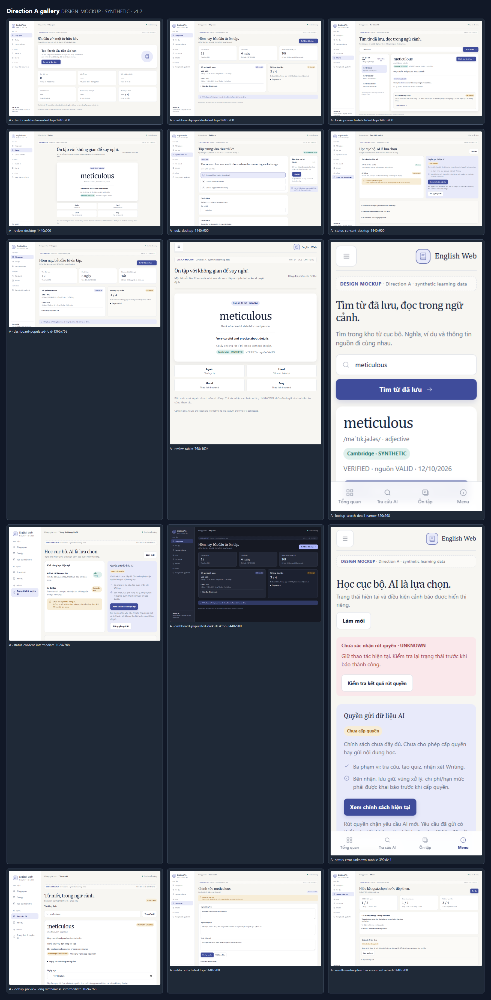
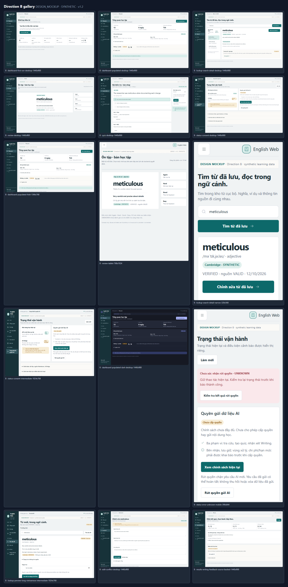

# UXR-01 visual gallery — v1.2

**CURRENT_DIRECTION:** **B — Compact Study Console v1.2, OWNER_APPROVED** (D1/D2/D3/D4/D6/D8/D9 approved 13/10/2026). Direction A remains a preserved historical comparison reference. 27 original full-resolution PNGs for A and 27 for B remain unchanged. All task originals are **DESIGN_MOCKUP / SYNTHETIC**, rendered in installed Chrome from standalone local HTML; they are not production React screenshots, real study records, provider output, or proof of persistence.

Open an individual filename below for its original PNG. The desktop/mobile/fold names denote exact image and CSS viewport dimensions, not a downsampled export. A visible viewport may continue below its fold; full resolution does not mean a full-page screenshot.

Compare [A/B six-scenario board](assets/contact-sheets/ab-comparison.png), [A contact sheet](assets/contact-sheets/a-gallery.png), [B contact sheet](assets/contact-sheets/b-gallery.png), [scores and nine-group analysis](UXR-01-DIRECTION-COMPARISON.md), or the [final owner decision sheet](UXR-01-DESIGN-DECISION.md). Contact sheets aid comparison and never replace the individual originals. [Image manifest](assets/image-manifest.json) provides exact dimensions, bytes and SHA256.

## Direction A v1.2

Calm Academic Workspace. All rows: UXR-01, DESIGN_MOCKUP, synthetic data YES, version v1.2, 12/10/2026.

| Image ID / Task | Group | Route / state | Direction | Viewport CSS / PNG | Theme | Evidence / synthetic | Version | Full-resolution original |
|---|---|---|---|---|---|---|---|---|
| A01 / UXR-01 | G1/G9 | `/` — First-run: due 0; unknown streak; no attempts | A | 1440×900 | light | DESIGN_MOCKUP / YES | v1.2 | [dashboard-first-run-desktop-1440x900.png](assets/a/dashboard-first-run-desktop-1440x900.png) |
| A02 / UXR-01 | G1/G9 | `/` — First-run: due 0; unknown streak; no attempts | A | 390×844 | light | DESIGN_MOCKUP / YES | v1.2 | [dashboard-first-run-mobile-390x844.png](assets/a/dashboard-first-run-mobile-390x844.png) |
| A03 / UXR-01 | G1/G9 | `/` — Populated: due 12; streak 6; independent result types | A | 1440×900 | light | DESIGN_MOCKUP / YES | v1.2 | [dashboard-populated-desktop-1440x900.png](assets/a/dashboard-populated-desktop-1440x900.png) |
| A04 / UXR-01 | G1/G9 | `/` — Populated: due 12; streak 6; independent result types | A | 390×844 | light | DESIGN_MOCKUP / YES | v1.2 | [dashboard-populated-mobile-390x844.png](assets/a/dashboard-populated-mobile-390x844.png) |
| A05 / UXR-01 | G1/G3 | `/search → /word-forms/:id` — Stored Search and selected Detail; not an AI lookup response | A | 1440×900 | light | DESIGN_MOCKUP / YES | v1.2 | [lookup-search-detail-desktop-1440x900.png](assets/a/lookup-search-detail-desktop-1440x900.png) |
| A06 / UXR-01 | G1/G3 | `/search → /word-forms/:id` — Stored Search and selected Detail; not an AI lookup response | A | 390×844 | light | DESIGN_MOCKUP / YES | v1.2 | [lookup-search-detail-mobile-390x844.png](assets/a/lookup-search-detail-mobile-390x844.png) |
| A07 / UXR-01 | G1/G5 | `/review` — Revealed word/meaning; four backend-defined rating choices | A | 1440×900 | light | DESIGN_MOCKUP / YES | v1.2 | [review-desktop-1440x900.png](assets/a/review-desktop-1440x900.png) |
| A08 / UXR-01 | G1/G5 | `/review` — Revealed word/meaning; four backend-defined rating choices | A | 390×844 | light | DESIGN_MOCKUP / YES | v1.2 | [review-mobile-390x844.png](assets/a/review-mobile-390x844.png) |
| A09 / UXR-01 | G1/G6 | `/quiz/:attemptId` — IN_PROGRESS multiple-question attempt; acknowledged draft | A | 1440×900 | light | DESIGN_MOCKUP / YES | v1.2 | [quiz-desktop-1440x900.png](assets/a/quiz-desktop-1440x900.png) |
| A10 / UXR-01 | G1/G6 | `/quiz/:attemptId` — IN_PROGRESS multiple-question attempt; acknowledged draft | A | 390×844 | light | DESIGN_MOCKUP / YES | v1.2 | [quiz-mobile-390x844.png](assets/a/quiz-mobile-390x844.png) |
| A11 / UXR-01 | G1/G8 | `/status#ai-consent` — Local ready; AI unknown; incomplete policy; no grant | A | 1440×900 | light | DESIGN_MOCKUP / YES | v1.2 | [status-consent-desktop-1440x900.png](assets/a/status-consent-desktop-1440x900.png) |
| A12 / UXR-01 | G1/G8 | `/status#ai-consent` — Local ready; AI unknown; incomplete policy; no grant | A | 390×844 | light | DESIGN_MOCKUP / YES | v1.2 | [status-consent-mobile-390x844.png](assets/a/status-consent-mobile-390x844.png) |
| A13 / UXR-01 | G1/G9 | `/` — Populated: due 12; streak 6; independent result types | A | 1366×768 | light | DESIGN_MOCKUP / YES | v1.2 | [dashboard-populated-fold-1366x768.png](assets/a/dashboard-populated-fold-1366x768.png) |
| A14 / UXR-01 | G1/G5 | `/review` — Revealed word/meaning; four backend-defined rating choices | A | 768×1024 | light | DESIGN_MOCKUP / YES | v1.2 | [review-tablet-768x1024.png](assets/a/review-tablet-768x1024.png) |
| A15 / UXR-01 | G1/G3 | `/search → /word-forms/:id` — Stored Search and selected Detail; not an AI lookup response | A | 320×568 | light | DESIGN_MOCKUP / YES | v1.2 | [lookup-search-detail-narrow-320x568.png](assets/a/lookup-search-detail-narrow-320x568.png) |
| A16 / UXR-01 | G1/G8 | `/status#ai-consent` — Local ready; AI unknown; incomplete policy; no grant | A | 1024×768 | light | DESIGN_MOCKUP / YES | v1.2 | [status-consent-intermediate-1024x768.png](assets/a/status-consent-intermediate-1024x768.png) |
| A17 / UXR-01 | G1/G9 | `/` — Populated: due 12; streak 6; independent result types | A | 1440×900 | dark | DESIGN_MOCKUP / YES | v1.2 | [dashboard-populated-dark-desktop-1440x900.png](assets/a/dashboard-populated-dark-desktop-1440x900.png) |
| A18 / UXR-01 | G1/G8 | `/status#ai-consent` — Unconfirmed revoke UNKNOWN + offline bridge + local ready | A | 390×844 | light | DESIGN_MOCKUP / YES | v1.2 | [status-error-unknown-mobile-390x844.png](assets/a/status-error-unknown-mobile-390x844.png) |
| A19 / UXR-01 | G1/G2/G4 | `/lookup` — Synthetic AI preview, UNVERIFIED source; not saved; date/source save section | A | 1024×768 | light | DESIGN_MOCKUP / YES | v1.2 | [lookup-preview-long-vietnamese-intermediate-1024x768.png](assets/a/lookup-preview-long-vietnamese-intermediate-1024x768.png) |
| A20 / UXR-01 | G1/G4 | `/word-forms/:id` — Bilingual retained edit draft / REVISION_CONFLICT / explicit source reread | A | 1440×900 | light | DESIGN_MOCKUP / YES | v1.2 | [edit-conflict-desktop-1440x900.png](assets/a/edit-conflict-desktop-1440x900.png) |
| A21 / UXR-01 | G1/G7 | `/quiz/:attemptId/result` — SUBMITTED objective/self-score separate; advisory AI not requested; SOURCE_BACKED current state NOT_VERIFIED | A | 1440×900 | light | DESIGN_MOCKUP / YES | v1.2 | [results-writing-feedback-source-backed-1440x900.png](assets/a/results-writing-feedback-source-backed-1440x900.png) |
| A22 / UXR-01 | G1 | `Current routes / menu` — Mobile open drawer concept; close, groups and consent entry | A | 320×568 | light | DESIGN_MOCKUP / YES | v1.2 | [navigation-drawer-narrow-320x568.png](assets/a/navigation-drawer-narrow-320x568.png) |
| A23 / UXR-01 | G1/G4 | `/word-forms/:id` — Bilingual retained edit draft / REVISION_CONFLICT / explicit source reread | A | 390×844 | light | DESIGN_MOCKUP / YES | v1.2 | [edit-conflict-mobile-390x844.png](assets/a/edit-conflict-mobile-390x844.png) |
| A24 / UXR-01 | G1/G7 | `/quiz/:attemptId/result` — SUBMITTED objective/self-score separate; advisory AI not requested; SOURCE_BACKED current state NOT_VERIFIED | A | 390×844 | light | DESIGN_MOCKUP / YES | v1.2 | [results-writing-feedback-mobile-390x844.png](assets/a/results-writing-feedback-mobile-390x844.png) |
| A25 / UXR-01 | G1/G8 | `/status#ai-consent` — Unconfirmed revoke UNKNOWN + offline bridge + local ready | A | 1440×900 | dark | DESIGN_MOCKUP / YES | v1.2 | [status-error-consent-dark-desktop-1440x900.png](assets/a/status-error-consent-dark-desktop-1440x900.png) |
| A26 / UXR-01 | G1/G6/G8 | `/quiz/:attemptId` — UNKNOWN autosave; same-intent reconciliation; submit disabled | A | 390×844 | light | DESIGN_MOCKUP / YES | v1.2 | [quiz-autosave-unknown-mobile-390x844.png](assets/a/quiz-autosave-unknown-mobile-390x844.png) |
| A27 / UXR-01 | G1/G5/G8 | `/review` — UNKNOWN rating receipt; same-intent check; new ratings disabled | A | 390×844 | light | DESIGN_MOCKUP / YES | v1.2 | [review-rating-unknown-mobile-390x844.png](assets/a/review-rating-unknown-mobile-390x844.png) |

## Direction B v1.2

Compact Study Console. All rows: UXR-01, DESIGN_MOCKUP, synthetic data YES, version v1.2, 12/10/2026.

| Image ID / Task | Group | Route / state | Direction | Viewport CSS / PNG | Theme | Evidence / synthetic | Version | Full-resolution original |
|---|---|---|---|---|---|---|---|---|
| B01 / UXR-01 | G1/G9 | `/` — First-run: due 0; unknown streak; no attempts | B | 1440×900 | light | DESIGN_MOCKUP / YES | v1.2 | [dashboard-first-run-desktop-1440x900.png](assets/b/dashboard-first-run-desktop-1440x900.png) |
| B02 / UXR-01 | G1/G9 | `/` — First-run: due 0; unknown streak; no attempts | B | 390×844 | light | DESIGN_MOCKUP / YES | v1.2 | [dashboard-first-run-mobile-390x844.png](assets/b/dashboard-first-run-mobile-390x844.png) |
| B03 / UXR-01 | G1/G9 | `/` — Populated: due 12; streak 6; independent result types | B | 1440×900 | light | DESIGN_MOCKUP / YES | v1.2 | [dashboard-populated-desktop-1440x900.png](assets/b/dashboard-populated-desktop-1440x900.png) |
| B04 / UXR-01 | G1/G9 | `/` — Populated: due 12; streak 6; independent result types | B | 390×844 | light | DESIGN_MOCKUP / YES | v1.2 | [dashboard-populated-mobile-390x844.png](assets/b/dashboard-populated-mobile-390x844.png) |
| B05 / UXR-01 | G1/G3 | `/search → /word-forms/:id` — Stored Search and selected Detail; not an AI lookup response | B | 1440×900 | light | DESIGN_MOCKUP / YES | v1.2 | [lookup-search-detail-desktop-1440x900.png](assets/b/lookup-search-detail-desktop-1440x900.png) |
| B06 / UXR-01 | G1/G3 | `/search → /word-forms/:id` — Stored Search and selected Detail; not an AI lookup response | B | 390×844 | light | DESIGN_MOCKUP / YES | v1.2 | [lookup-search-detail-mobile-390x844.png](assets/b/lookup-search-detail-mobile-390x844.png) |
| B07 / UXR-01 | G1/G5 | `/review` — Revealed word/meaning; four backend-defined rating choices | B | 1440×900 | light | DESIGN_MOCKUP / YES | v1.2 | [review-desktop-1440x900.png](assets/b/review-desktop-1440x900.png) |
| B08 / UXR-01 | G1/G5 | `/review` — Revealed word/meaning; four backend-defined rating choices | B | 390×844 | light | DESIGN_MOCKUP / YES | v1.2 | [review-mobile-390x844.png](assets/b/review-mobile-390x844.png) |
| B09 / UXR-01 | G1/G6 | `/quiz/:attemptId` — IN_PROGRESS multiple-question attempt; acknowledged draft | B | 1440×900 | light | DESIGN_MOCKUP / YES | v1.2 | [quiz-desktop-1440x900.png](assets/b/quiz-desktop-1440x900.png) |
| B10 / UXR-01 | G1/G6 | `/quiz/:attemptId` — IN_PROGRESS multiple-question attempt; acknowledged draft | B | 390×844 | light | DESIGN_MOCKUP / YES | v1.2 | [quiz-mobile-390x844.png](assets/b/quiz-mobile-390x844.png) |
| B11 / UXR-01 | G1/G8 | `/status#ai-consent` — Local ready; AI unknown; incomplete policy; no grant | B | 1440×900 | light | DESIGN_MOCKUP / YES | v1.2 | [status-consent-desktop-1440x900.png](assets/b/status-consent-desktop-1440x900.png) |
| B12 / UXR-01 | G1/G8 | `/status#ai-consent` — Local ready; AI unknown; incomplete policy; no grant | B | 390×844 | light | DESIGN_MOCKUP / YES | v1.2 | [status-consent-mobile-390x844.png](assets/b/status-consent-mobile-390x844.png) |
| B13 / UXR-01 | G1/G9 | `/` — Populated: due 12; streak 6; independent result types | B | 1366×768 | light | DESIGN_MOCKUP / YES | v1.2 | [dashboard-populated-fold-1366x768.png](assets/b/dashboard-populated-fold-1366x768.png) |
| B14 / UXR-01 | G1/G5 | `/review` — Revealed word/meaning; four backend-defined rating choices | B | 768×1024 | light | DESIGN_MOCKUP / YES | v1.2 | [review-tablet-768x1024.png](assets/b/review-tablet-768x1024.png) |
| B15 / UXR-01 | G1/G3 | `/search → /word-forms/:id` — Stored Search and selected Detail; not an AI lookup response | B | 320×568 | light | DESIGN_MOCKUP / YES | v1.2 | [lookup-search-detail-narrow-320x568.png](assets/b/lookup-search-detail-narrow-320x568.png) |
| B16 / UXR-01 | G1/G8 | `/status#ai-consent` — Local ready; AI unknown; incomplete policy; no grant | B | 1024×768 | light | DESIGN_MOCKUP / YES | v1.2 | [status-consent-intermediate-1024x768.png](assets/b/status-consent-intermediate-1024x768.png) |
| B17 / UXR-01 | G1/G9 | `/` — Populated: due 12; streak 6; independent result types | B | 1440×900 | dark | DESIGN_MOCKUP / YES | v1.2 | [dashboard-populated-dark-desktop-1440x900.png](assets/b/dashboard-populated-dark-desktop-1440x900.png) |
| B18 / UXR-01 | G1/G8 | `/status#ai-consent` — Unconfirmed revoke UNKNOWN + offline bridge + local ready | B | 390×844 | light | DESIGN_MOCKUP / YES | v1.2 | [status-error-unknown-mobile-390x844.png](assets/b/status-error-unknown-mobile-390x844.png) |
| B19 / UXR-01 | G1/G2/G4 | `/lookup` — Synthetic AI preview, UNVERIFIED source; not saved; date/source save section | B | 1024×768 | light | DESIGN_MOCKUP / YES | v1.2 | [lookup-preview-long-vietnamese-intermediate-1024x768.png](assets/b/lookup-preview-long-vietnamese-intermediate-1024x768.png) |
| B20 / UXR-01 | G1/G4 | `/word-forms/:id` — Bilingual retained edit draft / REVISION_CONFLICT / explicit source reread | B | 1440×900 | light | DESIGN_MOCKUP / YES | v1.2 | [edit-conflict-desktop-1440x900.png](assets/b/edit-conflict-desktop-1440x900.png) |
| B21 / UXR-01 | G1/G7 | `/quiz/:attemptId/result` — SUBMITTED objective/self-score separate; advisory AI not requested; SOURCE_BACKED current state NOT_VERIFIED | B | 1440×900 | light | DESIGN_MOCKUP / YES | v1.2 | [results-writing-feedback-source-backed-1440x900.png](assets/b/results-writing-feedback-source-backed-1440x900.png) |
| B22 / UXR-01 | G1 | `Current routes / menu` — Mobile open drawer concept; close, groups and consent entry | B | 320×568 | light | DESIGN_MOCKUP / YES | v1.2 | [navigation-drawer-narrow-320x568.png](assets/b/navigation-drawer-narrow-320x568.png) |
| B23 / UXR-01 | G1/G4 | `/word-forms/:id` — Bilingual retained edit draft / REVISION_CONFLICT / explicit source reread | B | 390×844 | light | DESIGN_MOCKUP / YES | v1.2 | [edit-conflict-mobile-390x844.png](assets/b/edit-conflict-mobile-390x844.png) |
| B24 / UXR-01 | G1/G7 | `/quiz/:attemptId/result` — SUBMITTED objective/self-score separate; advisory AI not requested; SOURCE_BACKED current state NOT_VERIFIED | B | 390×844 | light | DESIGN_MOCKUP / YES | v1.2 | [results-writing-feedback-mobile-390x844.png](assets/b/results-writing-feedback-mobile-390x844.png) |
| B25 / UXR-01 | G1/G8 | `/status#ai-consent` — Unconfirmed revoke UNKNOWN + offline bridge + local ready | B | 1440×900 | dark | DESIGN_MOCKUP / YES | v1.2 | [status-error-consent-dark-desktop-1440x900.png](assets/b/status-error-consent-dark-desktop-1440x900.png) |
| B26 / UXR-01 | G1/G6/G8 | `/quiz/:attemptId` — UNKNOWN autosave; same-intent reconciliation; submit disabled | B | 390×844 | light | DESIGN_MOCKUP / YES | v1.2 | [quiz-autosave-unknown-mobile-390x844.png](assets/b/quiz-autosave-unknown-mobile-390x844.png) |
| B27 / UXR-01 | G1/G5/G8 | `/review` — UNKNOWN rating receipt; same-intent check; new ratings disabled | B | 390×844 | light | DESIGN_MOCKUP / YES | v1.2 | [review-rating-unknown-mobile-390x844.png](assets/b/review-rating-unknown-mobile-390x844.png) |

## Baseline current-app images — UXR-00

The accessible [original baseline inventory and issues](research/uxr00/A3-browser/REPORT.md) explain the actual captured route/state, fixture category and source. The local originals were copied byte-for-byte; manifest hashes verify the copies. They are **CURRENT_APP_CAPTURE**, never proposed A/B visuals. No current G7 or populated G9 capture exists. Narrow legacy G8 Status filenames do not prove consent-section reachability.

| Task / group | Route / state | Direction / version / theme | Evidence / synthetic | CSS / PNG viewport | Full-resolution baseline |
|---|---|---|---|---|---|
| UXR-00 / G1 | `/` — See original screenshot inventory | BASELINE / audit-c2417ba6 / as captured | CURRENT_APP_CAPTURE / REAL_RENDERED / NO (isolated local state) | 1440×900 | [G1-shell-desktop-REAL_RENDERED-1440x900.png](research/uxr00/A3-browser/screenshots/G1-shell-desktop-REAL_RENDERED-1440x900.png) |
| UXR-00 / G1 | `/` — See original screenshot inventory | BASELINE / audit-c2417ba6 / as captured | CURRENT_APP_CAPTURE / REAL_RENDERED / NO (isolated local state) | 320×568 | [G1-shell-narrow-REAL_RENDERED-320x568.png](research/uxr00/A3-browser/screenshots/G1-shell-narrow-REAL_RENDERED-320x568.png) |
| UXR-00 / G2 | `/lookup` — See original screenshot inventory | BASELINE / audit-c2417ba6 / as captured | CURRENT_APP_CAPTURE / REAL_RENDERED / NO (isolated local state) | 1440×900 | [G2-lookup-idle-REAL_RENDERED-1440x900.png](research/uxr00/A3-browser/screenshots/G2-lookup-idle-REAL_RENDERED-1440x900.png) |
| UXR-00 / G2 | `/lookup` — See original screenshot inventory | BASELINE / audit-c2417ba6 / as captured | CURRENT_APP_CAPTURE / REAL_RENDERED / NO (isolated local state) | 1440×900 | [G2-lookup-invalid-REAL_RENDERED-1440x900.png](research/uxr00/A3-browser/screenshots/G2-lookup-invalid-REAL_RENDERED-1440x900.png) |
| UXR-00 / G2 | `/lookup` — See original screenshot inventory | BASELINE / audit-c2417ba6 / as captured | CURRENT_APP_CAPTURE / SYNTHETIC_RENDERED / YES | 1440×900 | [G2-lookup-preview-SYNTHETIC_RENDERED-1440x900.png](research/uxr00/A3-browser/screenshots/G2-lookup-preview-SYNTHETIC_RENDERED-1440x900.png) |
| UXR-00 / G2 | `/lookup` — See original screenshot inventory | BASELINE / audit-c2417ba6 / as captured | CURRENT_APP_CAPTURE / SYNTHETIC_RENDERED / YES | 320×568 | [G2-lookup-preview-SYNTHETIC_RENDERED-320x568.png](research/uxr00/A3-browser/screenshots/G2-lookup-preview-SYNTHETIC_RENDERED-320x568.png) |
| UXR-00 / G2 | `/lookup` — See original screenshot inventory | BASELINE / audit-c2417ba6 / as captured | CURRENT_APP_CAPTURE / SYNTHETIC_RENDERED / YES | 1440×900 | [G2-missing-optional-SYNTHETIC_RENDERED-1440x900.png](research/uxr00/A3-browser/screenshots/G2-missing-optional-SYNTHETIC_RENDERED-1440x900.png) |
| UXR-00 / G3 | `/search` — See original screenshot inventory | BASELINE / audit-c2417ba6 / as captured | CURRENT_APP_CAPTURE / SYNTHETIC_RENDERED / YES | 1440×900 | [G3-search-populated-SYNTHETIC_RENDERED-1440x900.png](research/uxr00/A3-browser/screenshots/G3-search-populated-SYNTHETIC_RENDERED-1440x900.png) |
| UXR-00 / G3 | `/word-forms/:id` — See original screenshot inventory | BASELINE / audit-c2417ba6 / as captured | CURRENT_APP_CAPTURE / SYNTHETIC_RENDERED / YES | 1440×900 | [G3-word-detail-SYNTHETIC_RENDERED-1440x900.png](research/uxr00/A3-browser/screenshots/G3-word-detail-SYNTHETIC_RENDERED-1440x900.png) |
| UXR-00 / G4 | `/word-forms/:id` — See original screenshot inventory | BASELINE / audit-c2417ba6 / as captured | CURRENT_APP_CAPTURE / SYNTHETIC_RENDERED / YES | 1440×900 | [G4-edit-form-SYNTHETIC_RENDERED-1440x900.png](research/uxr00/A3-browser/screenshots/G4-edit-form-SYNTHETIC_RENDERED-1440x900.png) |
| UXR-00 / G5 | `/review` — See original screenshot inventory | BASELINE / audit-c2417ba6 / as captured | CURRENT_APP_CAPTURE / SYNTHETIC_RENDERED / YES | 1440×900 | [G5-review-populated-SYNTHETIC_RENDERED-1440x900.png](research/uxr00/A3-browser/screenshots/G5-review-populated-SYNTHETIC_RENDERED-1440x900.png) |
| UXR-00 / G5 | `/review` — See original screenshot inventory | BASELINE / audit-c2417ba6 / as captured | CURRENT_APP_CAPTURE / SYNTHETIC_RENDERED / YES | 320×568 | [G5-review-populated-SYNTHETIC_RENDERED-320x568.png](research/uxr00/A3-browser/screenshots/G5-review-populated-SYNTHETIC_RENDERED-320x568.png) |
| UXR-00 / G6 | `/quiz/new` — See original screenshot inventory | BASELINE / audit-c2417ba6 / as captured | CURRENT_APP_CAPTURE / REAL_RENDERED / NO (isolated local state) | 1440×900 | [G6-quiz-builder-REAL_RENDERED-1440x900.png](research/uxr00/A3-browser/screenshots/G6-quiz-builder-REAL_RENDERED-1440x900.png) |
| UXR-00 / G6 | `/quiz/:attemptId` — See original screenshot inventory | BASELINE / audit-c2417ba6 / as captured | CURRENT_APP_CAPTURE / SYNTHETIC_RENDERED / YES | 1440×900 | [G6-quiz-runner-SYNTHETIC_RENDERED-1440x900.png](research/uxr00/A3-browser/screenshots/G6-quiz-runner-SYNTHETIC_RENDERED-1440x900.png) |
| UXR-00 / G8 | `Consent dialog (initiating route not recorded)` — See original screenshot inventory | BASELINE / audit-c2417ba6 / as captured | CURRENT_APP_CAPTURE / SYNTHETIC_RENDERED / YES | 1440×900 | [G8-consent-dialog-SYNTHETIC_RENDERED-1440x900.png](research/uxr00/A3-browser/screenshots/G8-consent-dialog-SYNTHETIC_RENDERED-1440x900.png) |
| UXR-00 / G8 | `Consent dialog (initiating route not recorded)` — See original screenshot inventory | BASELINE / audit-c2417ba6 / as captured | CURRENT_APP_CAPTURE / SYNTHETIC_RENDERED / YES | 320×568 | [G8-consent-dialog-SYNTHETIC_RENDERED-320x568.png](research/uxr00/A3-browser/screenshots/G8-consent-dialog-SYNTHETIC_RENDERED-320x568.png) |
| UXR-00 / G8 | `/status` — Status top only; consent not visible | BASELINE / audit-c2417ba6 / as captured | CURRENT_APP_CAPTURE / REAL_RENDERED / NO (isolated local state) | 320×568 | [G8-status-consent-REAL_RENDERED-320x568.png](research/uxr00/A3-browser/screenshots/G8-status-consent-REAL_RENDERED-320x568.png) |
| UXR-00 / G8 | `/status` — Status top only; consent not visible | BASELINE / audit-c2417ba6 / as captured | CURRENT_APP_CAPTURE / SYNTHETIC_RENDERED / YES | 320×568 | [G8-status-consent-SYNTHETIC_RENDERED-320x568.png](research/uxr00/A3-browser/screenshots/G8-status-consent-SYNTHETIC_RENDERED-320x568.png) |
| UXR-00 / G8 | `/status` — See original screenshot inventory | BASELINE / audit-c2417ba6 / as captured | CURRENT_APP_CAPTURE / REAL_RENDERED / NO (isolated local state) | 1440×900 | [G8-status-REAL_RENDERED-1440x900.png](research/uxr00/A3-browser/screenshots/G8-status-REAL_RENDERED-1440x900.png) |
| UXR-00 / G9 | `/` — See original screenshot inventory | BASELINE / audit-c2417ba6 / as captured | CURRENT_APP_CAPTURE / REAL_RENDERED / NO (isolated local state) | 1440×900 | [G9-dashboard-first-run-REAL_RENDERED-1440x900.png](research/uxr00/A3-browser/screenshots/G9-dashboard-first-run-REAL_RENDERED-1440x900.png) |
| UXR-00 / G9 | `/` — See original screenshot inventory | BASELINE / audit-c2417ba6 / as captured | CURRENT_APP_CAPTURE / REAL_RENDERED / NO (isolated local state) | 320×568 | [G9-dashboard-first-run-REAL_RENDERED-320x568.png](research/uxr00/A3-browser/screenshots/G9-dashboard-first-run-REAL_RENDERED-320x568.png) |

## Contact-sheet metadata

Contact sheets are derived comparison assets, not additional original scenario captures. All are task UXR-01, group G1–G9 representative, direction as labelled, mixed route/state originals, DESIGN_MOCKUP / SYNTHETIC YES / v1.2. Their exact exported dimensions and hashes are in the manifest. They include only the task mockup images.

| Derived image | Direction | Purpose | Direct PNG |
|---|---|---|---|
| CS-A | A | Representative desktop/responsive/theme/state gallery | [A gallery](assets/contact-sheets/a-gallery.png) |
| CS-B | B | Equivalent representative gallery | [B gallery](assets/contact-sheets/b-gallery.png) |
| CS-AB | A/B | Equivalent six desktop scenarios side by side | [A/B comparison](assets/contact-sheets/ab-comparison.png) |

## Render provenance and caveats

The final standalone sources are [A HTML](assets/source/direction-a.html), [B HTML](assets/source/direction-b.html) and the [renderer](assets/source/render.mjs). They reuse no production page and make no HTTP/API/provider call. The appearance illustrates how canonical and proposed official components could be composed; it is not an installed Radix component demonstration. Static anchors/actions do not prove app navigation, autosave, consent, rating, or focus behavior.

G3/G4/G7 are source-backed concepts; the ledger distinguishes partial current captures from missing states. Error/UNKNOWN/offline and long Vietnamese data are meaningful proposed states; their actual application transitions remain NOT_VERIFIED.

Reviewing these screenshots does not automatically approve them. Choose a **named direction and version** and complete the owner decision sheet. UXR-01 remains pending; UXR-02 is not started.
