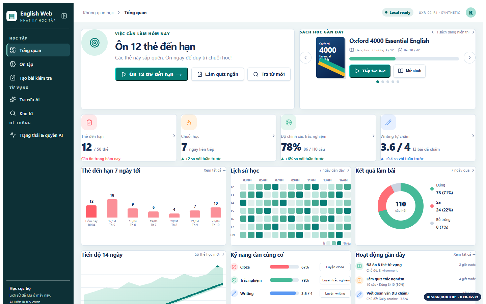

# UXR-02-R1 Owner Approval

> Historical R1 snapshot. Its pending decisions are superseded by the [2026-10-14 approval of R2 + HM-FIX](UXR-02-APPROVAL.md). R1 evidence remains archived.

**Status:** `OWNER_VISUAL_APPROVAL_PENDING`
**Correction version:** `UXR-02-R1 v1.0`
**Locked source:** [`dashboard-overview.png`](assets/references/dashboard-overview-owner-root.png)

## Corrected primary desktop view

[Open the corrected primary desktop image](assets/r1/uxr02-r1-dashboard-1440-expanded-light.png)

The image is a `DESIGN_MOCKUP`, rendered at 1440×900. It follows the locked Row 1–4 structure and uses synthetic values.

## Corrected states

- [Collapsed desktop with reopen affordance](assets/r1/uxr02-r1-dashboard-1440-collapsed-light.png)
- [Expanded dark with corrected CTA contrast](assets/r1/uxr02-r1-dashboard-1440-expanded-dark.png)
- [Mobile drawer closed](assets/r1/uxr02-r1-dashboard-390-closed-light.png)
- [Mobile drawer open with Status and AI consent](assets/r1/uxr02-r1-dashboard-390-open-light.png)
- [320px stress layout](assets/r1/uxr02-r1-dashboard-320-stress-light.png)
- [R1 comparison contact sheet](assets/r1/uxr02-r1-contact-sheet.png)

## Owner sign-off checklist

| Decision | Owner result |
|---|---|
| R1 Dashboard composition matches `dashboard-overview.png` | `PENDING` |
| Row 1 hero/book side-by-side on desktop | `PENDING` |
| Four KPI cards and Rows 3–4 order | `PENDING` |
| English Web / Nhật ký học tập branding | `PENDING` |
| Collapsed rail reopen affordance | `PENDING` |
| Status and AI consent access in all navigation states | `PENDING` |
| Dark-mode CTA contrast direction | `PENDING` |
| Mobile adaptation remains the same Dashboard system | `PENDING` |

Owner approval must name the approved R1 version or request a specific correction. This packet does not self-approve R1, mark UXR-02 done, or authorize UXR-02A.
