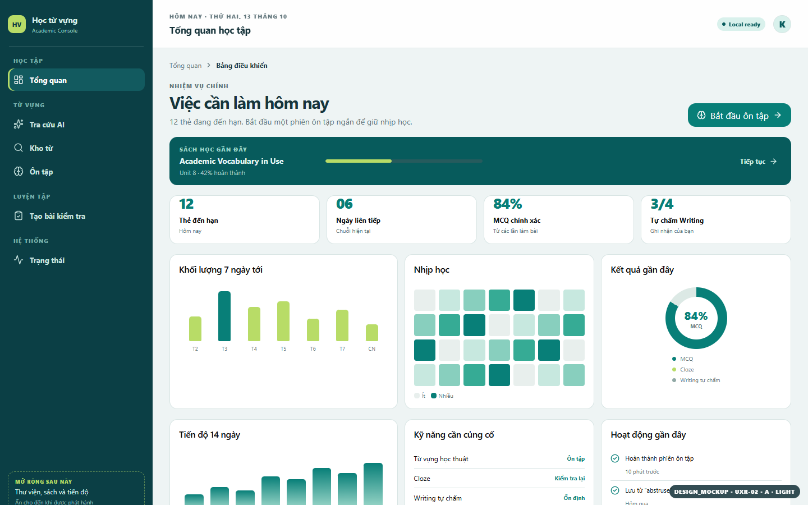
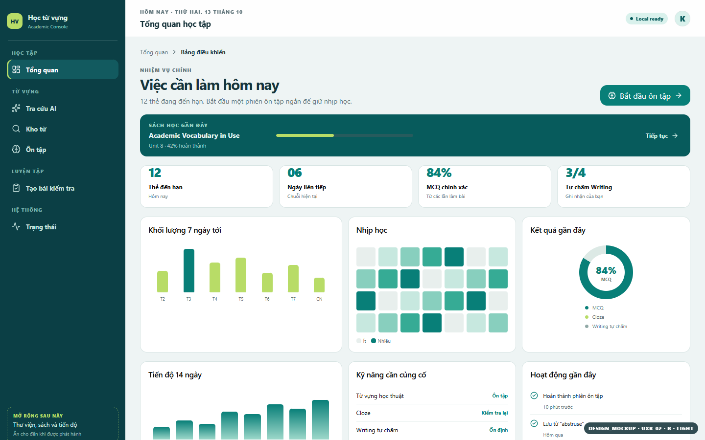

# UXR-02 Visual Review Packet

**Version:** `UXR-02 v1.0`
**Label:** every proposed image is `DESIGN_MOCKUP`; data is `SYNTHETIC_DESIGN_FIXTURE`.
**Owner state:** `APPROVED: UXR-02-R2 + HM-FIX`, 2026-10-14. This v1 gallery is archived; see [final approval gallery](UXR-02-APPROVAL.md).

## Quick comparison

[Open the full-resolution contact sheet](assets/uxr02-v1-contact-sheet.png) -> [HTML index](assets/contact-sheet.html)

| Alternative A | Alternative B |
|---|---|
|  |  |
| Taller 86px context header; 272px rail. | Compact 76px header; 256px rail; more first-fold room. |

**Coordinator recommendation:** Alternative B is the stronger shell candidate because it protects the owner-approved compact Dashboard hierarchy while keeping detail and focus contexts consistent. Historical recommendation; the owner selected refined R2 + HM-FIX, not either initial alternative.

## Image inventory

| File | State / viewport / theme | Truth label |
|---|---|---|
| [uxr02-v1-alt-a-dashboard-1440-expanded-light.png](assets/uxr02-v1-alt-a-dashboard-1440-expanded-light.png) | A Dashboard, 1440x900, expanded, light | DESIGN_MOCKUP |
| [uxr02-v1-alt-b-dashboard-1440-expanded-light.png](assets/uxr02-v1-alt-b-dashboard-1440-expanded-light.png) | B Dashboard, 1440x900, expanded, light | DESIGN_MOCKUP |
| [uxr02-v1-alt-a-dashboard-1440-collapsed-light.png](assets/uxr02-v1-alt-a-dashboard-1440-collapsed-light.png) | A collapsed rail, 1440x900, light | DESIGN_MOCKUP |
| [uxr02-v1-alt-b-detail-1440-light.png](assets/uxr02-v1-alt-b-detail-1440-light.png) | B word detail, 1440x900, light | DESIGN_MOCKUP |
| [uxr02-v1-alt-b-dashboard-1366-fold-light.png](assets/uxr02-v1-alt-b-dashboard-1366-fold-light.png) | B Dashboard initial fold, 1366x768, light | DESIGN_MOCKUP |
| [uxr02-v1-alt-b-dashboard-1024-light.png](assets/uxr02-v1-alt-b-dashboard-1024-light.png) | B intermediate shell, 1024x768, light | DESIGN_MOCKUP |
| [uxr02-v1-alt-b-focus-768-tablet-light.png](assets/uxr02-v1-alt-b-focus-768-tablet-light.png) | B focus mode, 768x1024, light | DESIGN_MOCKUP |
| [uxr02-v1-alt-b-dashboard-390-closed-light.png](assets/uxr02-v1-alt-b-dashboard-390-closed-light.png) | B mobile drawer closed, 390x844, light | DESIGN_MOCKUP |
| [uxr02-v1-alt-b-dashboard-390-open-light.png](assets/uxr02-v1-alt-b-dashboard-390-open-light.png) | B mobile drawer open, 390x844, light | DESIGN_MOCKUP |
| [uxr02-v1-alt-b-dashboard-320-stress-light.png](assets/uxr02-v1-alt-b-dashboard-320-stress-light.png) | B narrow stress, 320x568, light | DESIGN_MOCKUP |
| [uxr02-v1-alt-b-dashboard-1440-expanded-dark.png](assets/uxr02-v1-alt-b-dashboard-1440-expanded-dark.png) | B Dashboard, 1440x900, dark | DESIGN_MOCKUP |
| [uxr02-v1-alt-b-focus-1440-light.png](assets/uxr02-v1-alt-b-focus-1440-light.png) | B focus mode, 1440x900, light | DESIGN_MOCKUP |
| [uxr02-v1-alt-b-status-consent-1440-light.png](assets/uxr02-v1-alt-b-status-consent-1440-light.png) | B status/consent, 1440x900, light | DESIGN_MOCKUP |
| [uxr02-v1-alt-b-status-consent-1440-dark.png](assets/uxr02-v1-alt-b-status-consent-1440-dark.png) | B status/consent, 1440x900, dark | DESIGN_MOCKUP |

## Authentic baseline comparison

| Current source evidence | Proposed shell |
|---|---|
| [CURRENT_APP_CAPTURE desktop 1440x900](assets/current-app-capture/G1-shell-desktop-CURRENT_APP_CAPTURE-1440x900.png) | [DESIGN_MOCKUP B desktop 1440x900](assets/uxr02-v1-alt-b-dashboard-1440-expanded-light.png) |
| [CURRENT_APP_CAPTURE narrow 320x568](assets/current-app-capture/G1-shell-narrow-CURRENT_APP_CAPTURE-320x568.png) | [DESIGN_MOCKUP B mobile drawer open 390x844](assets/uxr02-v1-alt-b-dashboard-390-open-light.png) |

The proposal retains the current route set, skip link, heading focus/live-region intent and consent entry. It changes horizontal nav to grouped rail/drawer, adds breadcrumb context, and makes status semantics persistent. Current captures are evidence of the incumbent source state, not production acceptance of the redesign.

## Verification record

- Browser-rendered with Vite 8.3.1 and installed Google Chrome at `C:\Program Files\Google\Chrome\Application\chrome.exe`; no browser download.
- 14 PNGs at exact CSS viewport dimensions, device scale 1.
- 48-case Playwright viewport sweep: zero horizontal overflow.
- No claim of WCAG pass, screen-reader pass, router/history pass or production behavior; those require later harness evidence.
